<div align="center">

<picture>
  <source media="(prefers-color-scheme: dark)" srcset="docs/brand/logo-dark.svg">
  
</picture>

**A personal budget app that replaces a spreadsheet, not a bank.**

Multi-user, self-hosted, LAN-only by default. Each account's data lives in its own encrypted SQLite file, unlocked automatically by their own OIDC login - nobody, including an admin, can read another account's data without their key.

[](LICENSE)

</div>

Tally started as a replacement for a spreadsheet that had outgrown itself: a monthly category grid with real rollups, a debt ledger instead of a mutable "amount owed" cell, and (as of v2.0) automatic bank transaction import. It stays out of the way the rest of the time - no subscription, no cloud account, no telemetry.

<p align="center">
  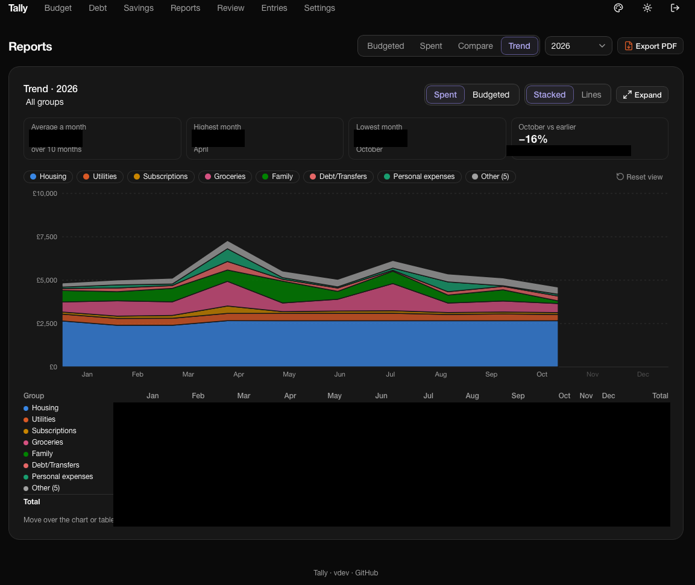
</p>

<p align="center"><sub>Figures in the Reports screenshots are blurred; everything else is a real (anonymized) instance.</sub></p>

<details>
<summary><b>More screenshots</b></summary>
<br>

<table>
  <tr>
    <td width="50%">
      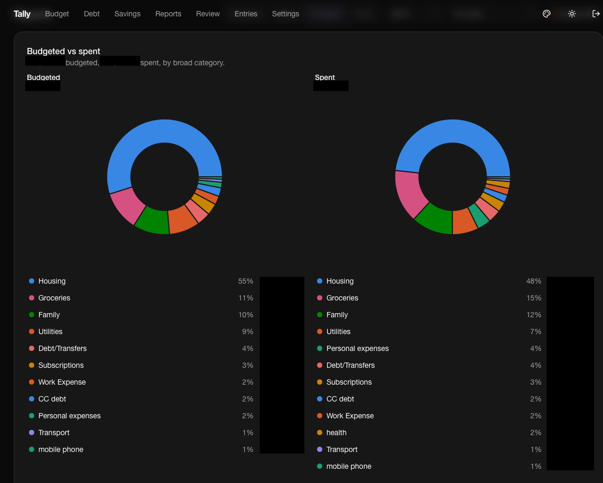
      <br><sub>Budgeted vs spent</sub>
    </td>
    <td width="50%">
      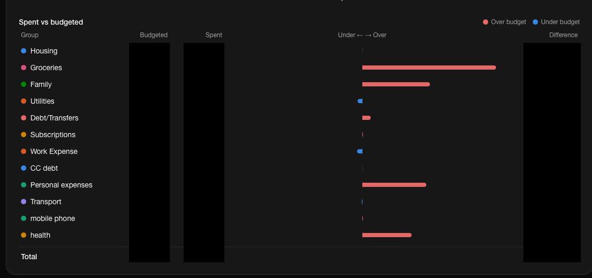
      <br><sub>Variance</sub>
    </td>
  </tr>
  <tr>
    <td width="50%">
      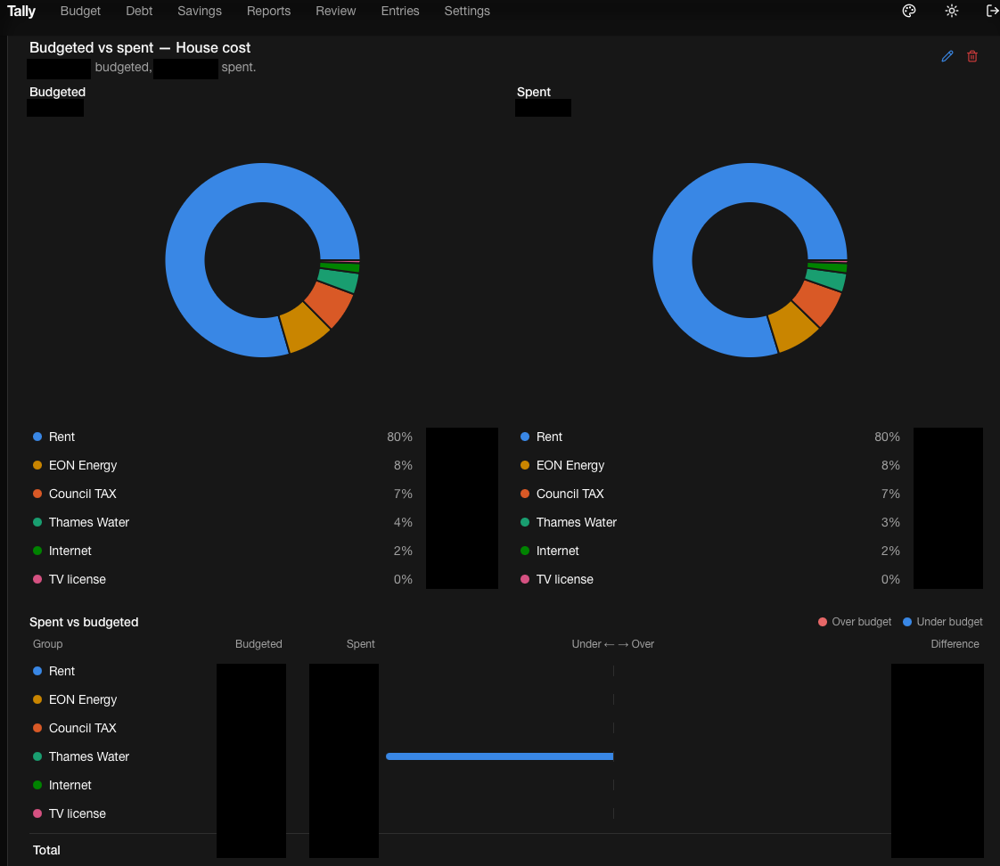
      <br><sub>Per-category report</sub>
    </td>
    <td width="50%">
      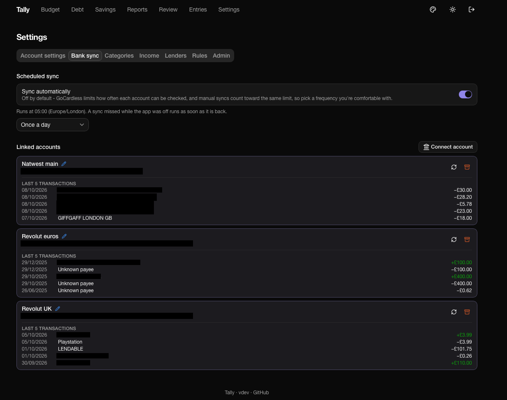
      <br><sub>Bank sync</sub>
    </td>
  </tr>
  <tr>
    <td width="50%">
      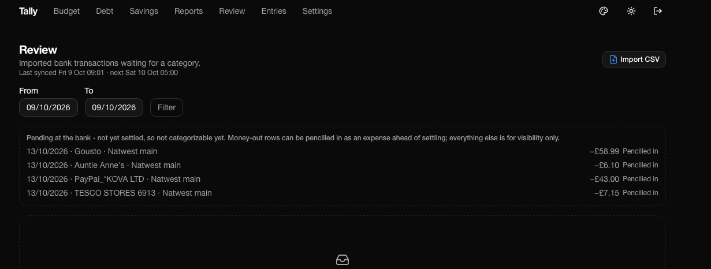
      <br><sub>Review queue</sub>
    </td>
    <td width="50%">
      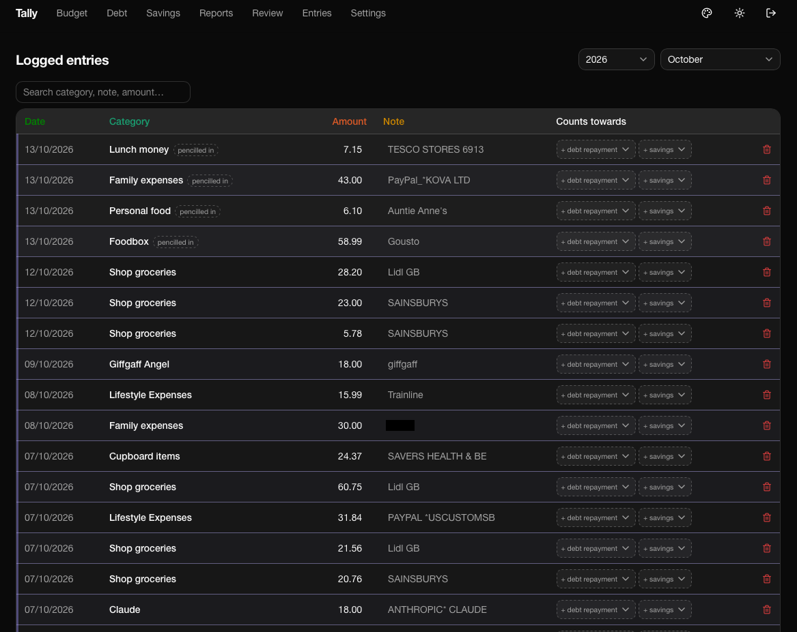
      <br><sub>Logged entries</sub>
    </td>
  </tr>
  <tr>
    <td width="50%">
      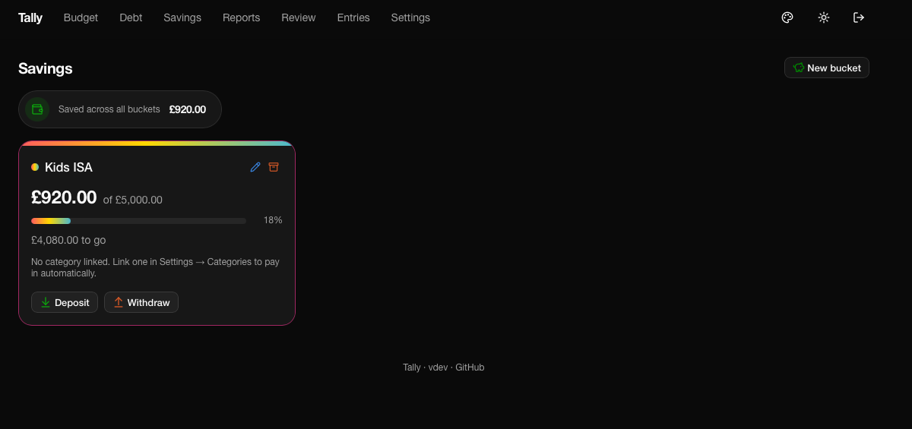
      <br><sub>Savings buckets</sub>
    </td>
    <td width="50%">
      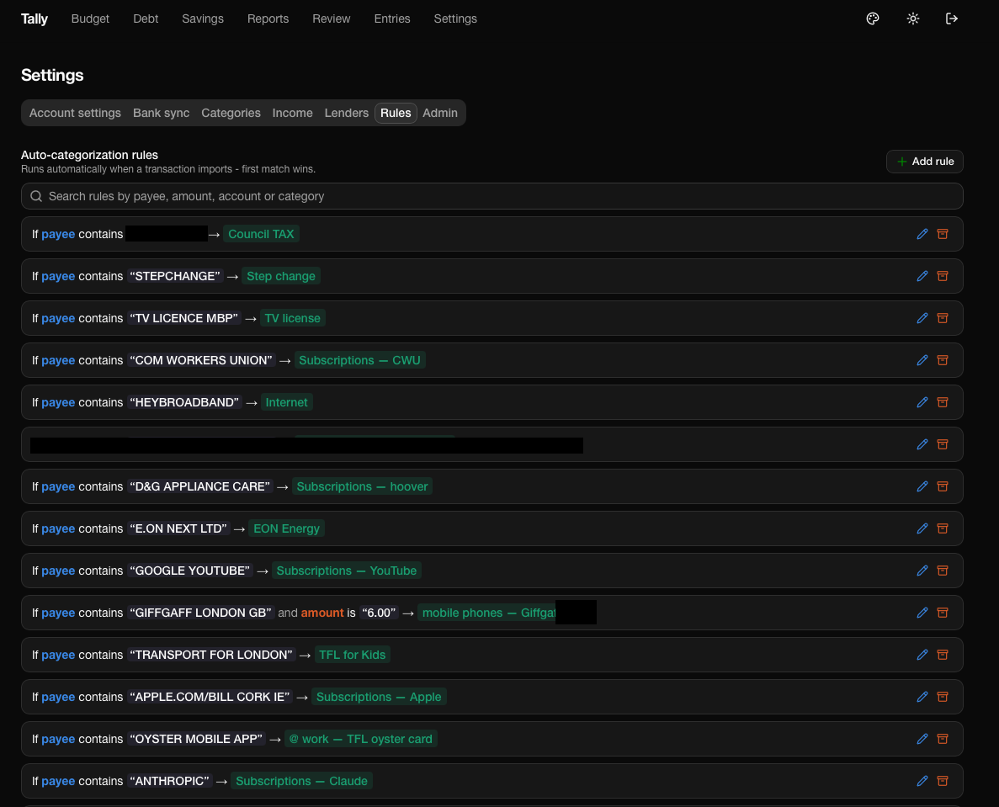
      <br><sub>Auto-categorization rules</sub>
    </td>
  </tr>
  <tr>
    <td width="50%">
      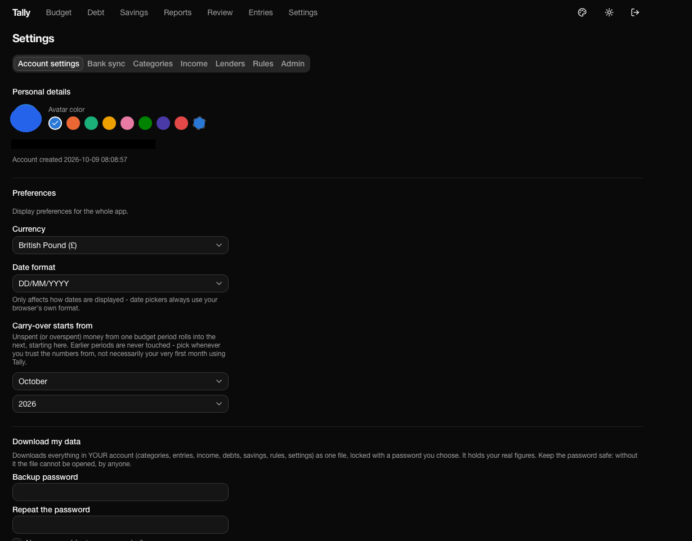
      <br><sub>Account settings</sub>
    </td>
    <td width="50%">
      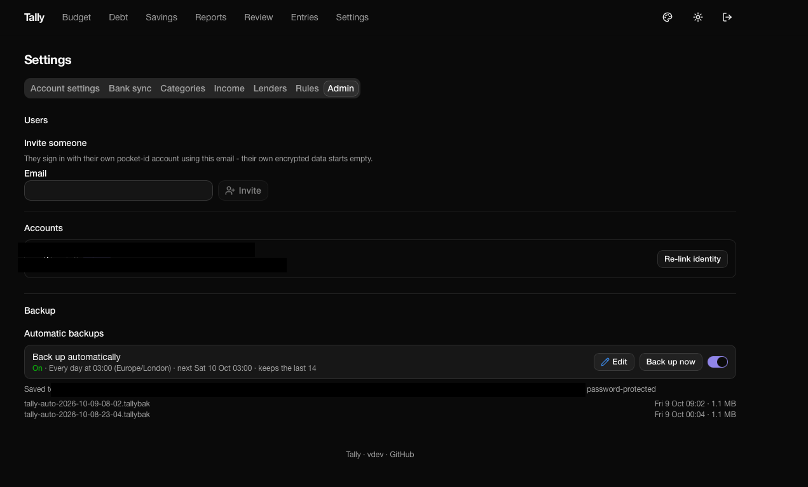
      <br><sub>Admin panel</sub>
    </td>
  </tr>
</table>

</details>

## Contents

1. [Features](#features)
2. [Get started](#get-started)
3. [Documentation](#documentation)
4. [Tech stack](#tech-stack)
5. [Structure](#structure)
6. [License](#license)

## Features

- **Budget grid**: categories (with sub-category rollups) x months, planned vs. actually spent, carries unspent money into the next period automatically from a point you choose
- **Debt ledger**: per-person running balance from loan/repayment entries, not a cell you overwrite by hand
- **Savings buckets**: goal + target date per bucket, deposits/withdrawals, optionally auto-funded from a linked category
- **Reports**: category spend grouped and charted by year/month - budgeted vs. spent, compare, trend, variance - exportable to PDF (landscape by default) for the whole page or a single panel
- **Bank sync**: connects real accounts via GoCardless Bank Account Data (one shared credential pair, admin-managed in Settings > Admin), stages imported transactions for review, auto-categorizes via explicit rules plus a learned-pattern fallback, flags possible duplicates against manual entries (suggestion only, never automatic); unsettled pending transactions can be "pencilled in" as a guess before they clear
- **CSV import**: for accounts not on GoCardless, or backfilling history
- **Backups**: automatic scheduled backups (admin-configured folder/password), plus every account gets its own scoped "download/restore my data" pair
- **Accounts**: invite people by email; admin status comes from an OIDC group claim (with a bootstrap-email fallback so a group misconfiguration can never lock every admin out), disable an account or delete it (a non-admin can delete their own; an admin can't self-delete), re-link a broken OIDC identity; a profile picture is generated from initials by default, or upload/link your own image (10MB cap)
- **Token-authed API** (see [API.md](API.md)) for a script or agent to read/write budget data without a browser session

## Get started

### Local development

```
npm install
npm run dev
```

Copy `.env.example` to `.env.local` and fill it in - see the comments in that file for what each value does.

### Self-host

```
curl -O https://raw.githubusercontent.com/tinkermesomething/tally/main/docker-compose.yml
curl -O https://raw.githubusercontent.com/tinkermesomething/tally/main/.env.example
mv .env.example .env   # then fill it in
docker compose up -d
```

Open `http://<host>:3000`. The container pulls a pre-built multi-arch image (`linux/amd64`, `linux/arm64`) from GHCR - nothing to build locally. Put it behind your own reverse proxy for TLS; there's no built-in rate limiting or network-layer protection, that's expected to live in front of it.

Migrations run automatically on boot - no separate migrate step needed, including on first run.

## Documentation

- [API.md](API.md) - the token-authenticated REST API for scripts/agents

## Tech stack

Next.js 15 (App Router, Turbopack) · TypeScript · Drizzle ORM + better-sqlite3 (SQLCipher-compatible fork) · Auth.js v5 (generic OIDC) · Tailwind · Base UI · recharts

One container, one SQLite file per account - each encrypted with a key sealed to that account's own OIDC identity, plus a small shared, unencrypted keystore file (account metadata and the GoCardless credential pair - never budget data).

## Structure

- `app/` - routes: `grid`, `entries`, `debt`, `reports`, `review` (bank-sync queue), `settings` (account, bank sync, categories, income, lenders, rules, admin), `api/v1` (the token API)
- `lib/db/` - schema plus all query/mutation logic, one file per domain (`queries.ts`, `debt.ts`, `bank-sync.ts`, `settings.ts`, `users.ts`); `context.ts`/`pool.ts`/`connection.ts` resolve which account's encrypted file the current request sees
- `lib/gocardless.ts` - the bank-sync API client
- `components/` - grouped by the route that owns them, plus `ui/` for the shared primitives

Money is always stored as integer pence, never float.

## License

MIT - see [LICENSE](LICENSE).
