<div align="center">

<picture>
  <source media="(prefers-color-scheme: dark)" srcset="docs/brand/logo-dark.svg">
  
</picture>

**Personal and household budgeting - the spreadsheet you've outgrown, not a bank. Self-host it, or run it as a desktop app.**

**[Download for macOS, Windows or Linux](https://github.com/tinkermesomething/tally/releases/latest)** &nbsp;·&nbsp; **[Self-host with Docker](#self-host)**

</div>

## Two ways to run Tally

| | **Desktop app** | **Self-hosted** |
|---|---|---|
| For | One person, on their own computer | A household, on a server you run |
| Install | Download an installer from [Releases](https://github.com/tinkermesomething/tally/releases/latest) | `docker compose up -d` ([steps](#self-host)) |
| Accounts | One local user, no login | Several people, each signs in with your OIDC provider |
| Bank sync | No. Import CSV files | Yes (EU/UK banks) |
| Household sharing | No | Yes |
| Your data | A folder on your computer, encrypted, key in your system keychain | Your server, one encrypted SQLite file per account |

It is the same app either way. Nobody, not even an admin, can read another account's data without their key. You decide how exposed a self-hosted install is; nothing about Tally makes that choice for you.

<div align="center">

[](LICENSE)

</div>

Tally started as a replacement for a spreadsheet that had outgrown itself: a monthly category grid with real rollups, a debt ledger instead of a mutable "amount owed" cell, and automatic bank transaction import. It stays out of the way the rest of the time - no subscription, no cloud account, no telemetry, no "upgrade to Pro."

It's built for one household (or one person) at a time, run on hardware you own. It is **not** a business accounting tool - no invoicing, no tax reporting, no multi-entity support, no double-entry bookkeeping. If you need any of that, Tally isn't it.

**Bank sync is EU/UK-only.** It connects through [GoCardless Bank Account Data](https://gocardless.com/bank-account-data/), which only reaches banks on the EU/UK Open Banking (PSD2) network - there's no path to US, Canadian, or other banks outside that network, and that's not a Tally limitation to fix, it's the scope of the one provider it integrates with. Everywhere else, CSV import covers the gap. The budgeting itself (currencies, categories, reports) isn't region-locked at all - only automatic bank sync is.

<p align="center">
  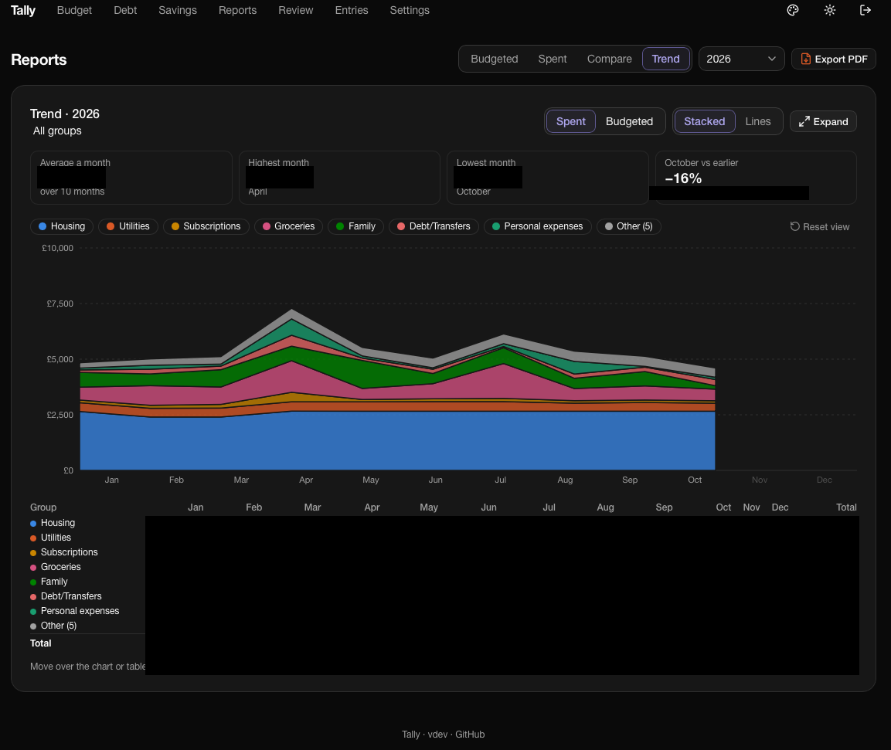
</p>

<p align="center"><sub>Figures in the Reports screenshots are blurred; everything else is a real (anonymized) instance.</sub></p>

<details>
<summary><b>More screenshots</b></summary>
<br>

<table>
  <tr>
    <td width="50%">
      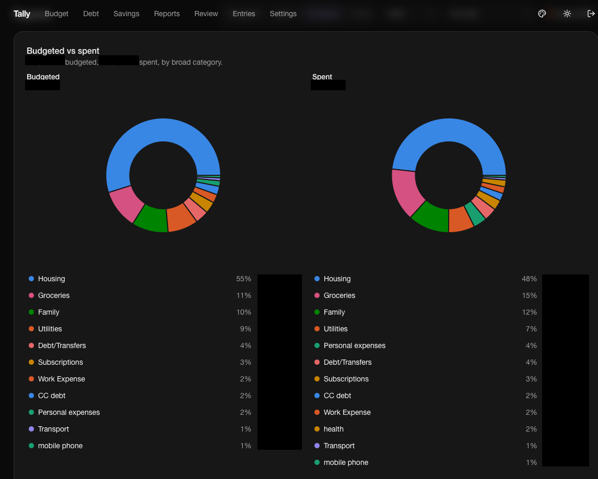
      <br><sub>Budgeted vs spent</sub>
    </td>
    <td width="50%">
      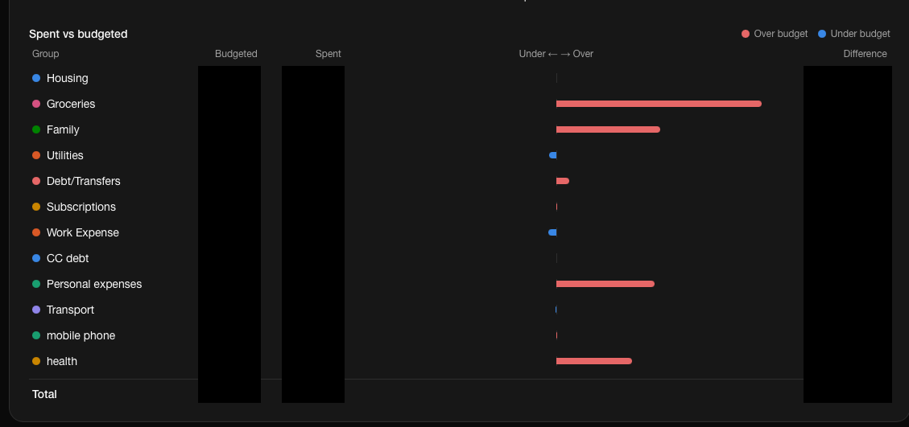
      <br><sub>Variance</sub>
    </td>
  </tr>
  <tr>
    <td width="50%">
      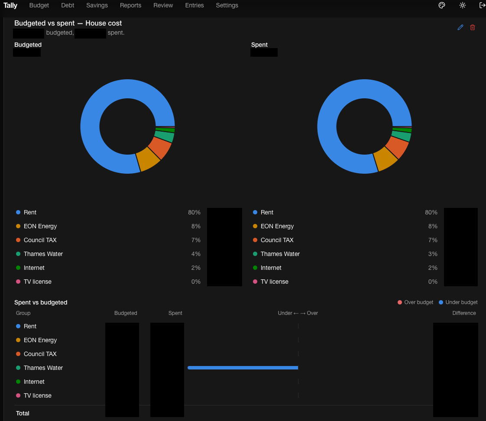
      <br><sub>Per-category report</sub>
    </td>
    <td width="50%">
      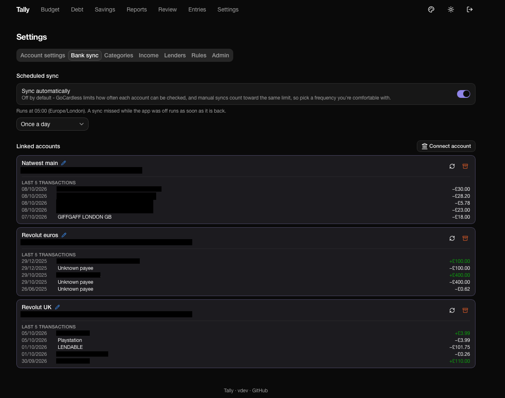
      <br><sub>Bank sync</sub>
    </td>
  </tr>
  <tr>
    <td width="50%">
      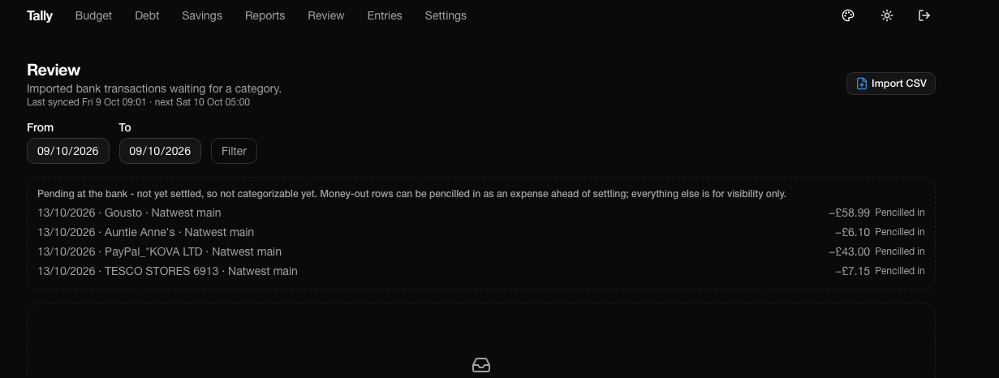
      <br><sub>Review queue</sub>
    </td>
    <td width="50%">
      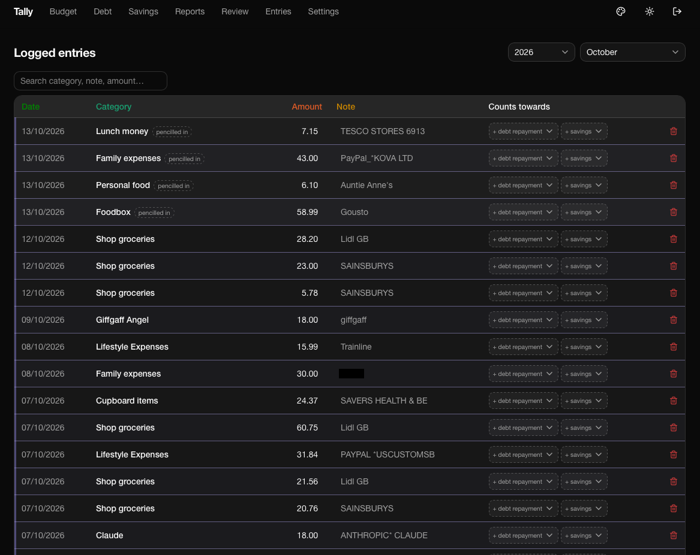
      <br><sub>Logged entries</sub>
    </td>
  </tr>
  <tr>
    <td width="50%">
      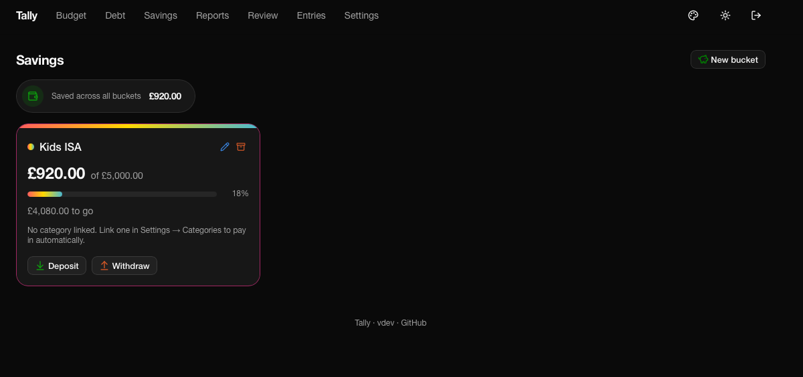
      <br><sub>Savings buckets</sub>
    </td>
    <td width="50%">
      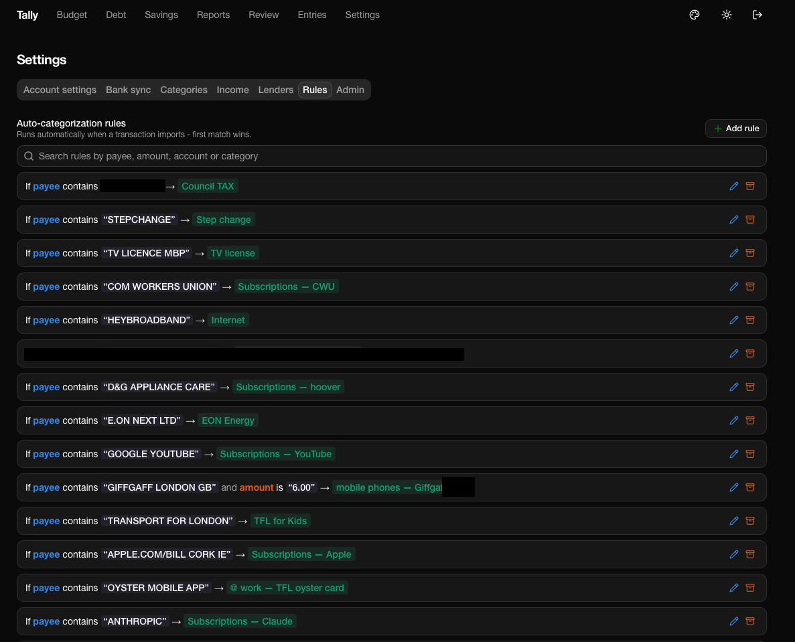
      <br><sub>Auto-categorization rules</sub>
    </td>
  </tr>
  <tr>
    <td width="50%">
      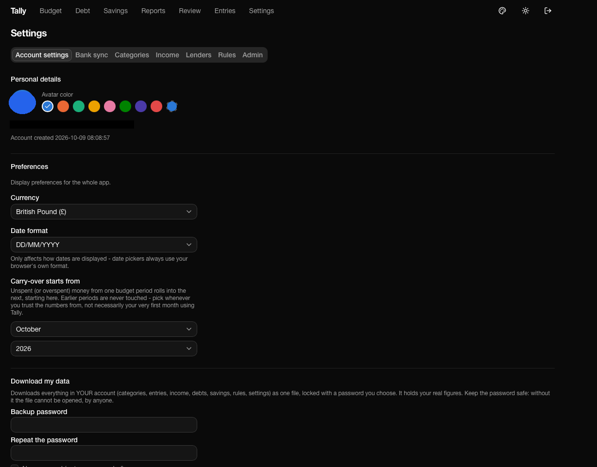
      <br><sub>Account settings</sub>
    </td>
    <td width="50%">
      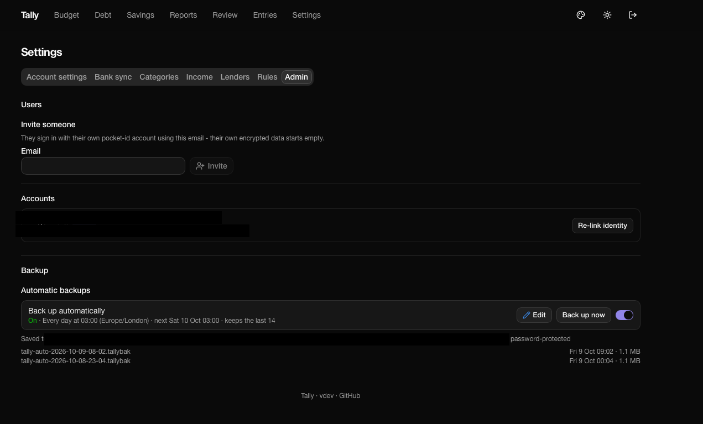
      <br><sub>Admin panel</sub>
    </td>
  </tr>
</table>

</details>

## Contents

1. [Two ways to run Tally](#two-ways-to-run-tally)
2. [Features](#features)
3. [Get started](#get-started)
4. [Desktop app](#desktop-app)
5. [Documentation](#documentation)
6. [Tech stack](#tech-stack)
7. [Structure](#structure)
8. [License](#license)

## Features

- **Budget grid**: categories (with sub-category rollups) x months, planned vs. actually spent, carries unspent money into the next period automatically from a point you choose
- **Household budget**: share specific categories and income sources into a combined household view - everyone's shared data merges by category name into one grid, nobody's full account or unshared categories are exposed to anyone else
- **Split entries**: any outgoing entry can be split across several categories (one shop order into pets + household). Splitting drops a debt/savings/household tag on the original, after an explicit confirm, because no single part can inherit it
- **Review and Entries in one page**: "To review" and "Logged" tabs under one nav item, opening on whichever has something waiting
- **Debt ledger**: per-person running balance from loan/repayment entries, not a cell you overwrite by hand
- **Savings buckets**: goal + target date per bucket, deposits/withdrawals, optionally auto-funded from a linked category
- **Net worth**: assets and linked bank accounts combined into one figure, tracked over time with a trend chart
- **Bills**: recurring bills with a due day, auto-populated into the grid each month so they're never forgotten
- **Reports**: category spend grouped and charted by year/month - budgeted vs. spent, compare (its total counts overspend only, so a saving elsewhere can't hide an overspend), trend, variance - exportable to PDF (landscape by default) for the whole page or a single panel
- **Bank sync** (EU/UK only - see above): connects real accounts via GoCardless Bank Account Data (one shared credential pair, admin-managed in Settings > Admin), stages imported transactions for review, auto-categorizes via explicit rules plus a learned-pattern fallback, flags possible duplicates against manual entries (suggestion only, never automatic); unsettled pending transactions can be "pencilled in" as a guess before they clear
- **CSV import**: for any account GoCardless can't reach - including every bank outside the EU/UK - or for backfilling history
- **Backups**: automatic scheduled backups (admin-configured folder/password), plus every account gets its own scoped "download/restore my data" pair
- **Accounts**: invite people by email. The very first admin is whoever first signs in with the address set as `ALLOWED_EMAIL` - that account is permanent and can never be disabled by anyone, even another admin, so a config mistake elsewhere can't lock everyone out. Anyone else becomes an admin only if your OIDC provider puts them in a group claim called `admin` (configurable via `OIDC_ADMIN_GROUP` if you already use that name for something else; optional either way - most single-household setups never need this); admin status is re-checked on every sign-in, so a group change at the provider takes effect on that person's next login. Admins can also disable/delete an account (a non-admin can delete their own; an admin can't self-delete) and re-link a broken OIDC identity; a profile picture is generated from initials by default, or upload/link your own image (10MB cap)
- **Token-authed API** (see [API.md](API.md)) for a script or agent to read/write budget data without a browser session

## Get started

### Local development

```
npm install
npm run dev
```

Copy `.env.example` to `.env.local` and fill it in - see the comments in that file for what each value does.

### Self-host

```
curl -O https://raw.githubusercontent.com/tinkermesomething/tally/main/docker-compose.yml
curl -O https://raw.githubusercontent.com/tinkermesomething/tally/main/.env.example
mv .env.example .env   # then fill it in
docker compose up -d
```

Open `http://<host>:3000`. The container pulls a pre-built multi-arch image (`linux/amd64`, `linux/arm64`) from GHCR - nothing to build locally.

The compose file above publishes port 3000 on every network interface, same as any other container - **Tally itself doesn't restrict who can reach it to your LAN.** Whether that ends up LAN-only, VPN-only, or exposed to the internet is entirely down to your own router/firewall/reverse-proxy setup. There's no built-in rate limiting or other network-layer protection either, so put it behind a reverse proxy with TLS, and don't expose it directly to the internet without one.

Migrations run automatically on boot - no separate migrate step needed, including on first run.

**On OIDC providers:** auth is built against [pocket-id](https://github.com/pocket-id/pocket-id) and tested only against it - that's the one the comments in `auth.config.ts` reference by name. The flow underneath (authorization code + PKCE, a `sub`/`email`/`groups` claim) is standard OIDC, so Authentik, Authelia, Keycloak, and similar should work, but none of them have actually been tried. If you use one of those and hit a snag, an issue with what broke is genuinely useful - this just hasn't been verified yet.

## Desktop app

Tally also ships as a desktop app for macOS, Windows and Linux, for people who don't want to run a server. It bundles everything it needs (its own Node runtime and the Tally server). It needs no Docker, no account and no internet connection.

It is the same app with these differences:

- **One local user, no login.** Multi-user, household sharing and OIDC are off.
- **No bank sync.** Import CSV files instead.
- **Your data stays on your computer**, in the same encrypted SQLite format. The key lives in the operating system's keychain (macOS Keychain, Windows Credential Manager, Linux Secret Service), so you never type it.

### Install

Download the installer for your system from [Releases](https://github.com/tinkermesomething/tally/releases). **The installers are unsigned**, so the system warns you the first time:

- **macOS:** right-click Tally in Applications, choose Open, then confirm. Or run `xattr -dr com.apple.quarantine /Applications/Tally.app`.
- **Windows:** SmartScreen says "unknown publisher". Choose More info, then Run anyway.
- **Linux:** make the AppImage executable, or install the `.deb`. Needs a running Secret Service (GNOME Keyring or KWallet).

Updates are checked at launch and install only if their signature matches the key built into the app. The signature proves an update is genuine. It does not remove the unsigned-installer warning above.

### Where your data is

| System | Default folder |
|---|---|
| macOS | `~/Library/Application Support/com.tally.desktop` |
| Windows | `%APPDATA%\com.tally.desktop` |
| Linux | `~/.local/share/com.tally.desktop` |

**Data > Show data folder** opens it. **Data > Change data folder...** moves it to an empty folder you choose. Tally copies everything, checks every file byte for byte, and only then switches. Your original is never deleted. If anything fails, nothing changes. If a custom folder later goes missing (an unplugged drive), Tally shows an error. It never starts a blank budget in its place.

Don't put the data folder inside iCloud, OneDrive, Dropbox or a network drive. A sync tool can copy a database half-way through a write and corrupt it. To keep a copy elsewhere, use backups.

### Backups

Automatic backups need a password, set in Settings. Without one, Tally makes no automatic backups, because they would be plain unencrypted copies of your budget. Set one soon after install.

### App lock (optional)

Settings > App lock asks for a password when Tally opens. It is off by default. The password is stored as a scrypt hash in `app-lock.json` in your data folder.

If you forget it, quit Tally and delete `app-lock.json`. Your data is not affected, because the lock is not what encrypts it.

### What this protects, and what it doesn't

- **Protected:** other programs and web pages cannot talk to Tally's local server. It listens on `127.0.0.1` only, on a random port. Every request must carry a cookie that only Tally's own window gets, and the Host header must match exactly. That stops a web page probing localhost, including DNS-rebinding tricks.
- **Protected:** your data file is encrypted. Copying it without the keychain entry gives an attacker nothing readable.
- **Not protected:** malware running as you. It can read the keychain and the server's environment. The app lock and the local gate do not change that. They keep out other people at your unlocked computer and other websites, not software running under your own account.
- **Lost keychain entry:** if the keychain entry is deleted or you move to a new computer, the data can't be opened. Tally refuses to create a new key over existing data. Keep a backup with a password.

### Build it yourself

```
npm install
npm run desktop:build     # needs Rust (stable); Linux also needs the Tauri system libraries
```

The installer lands in `src-tauri/target/release/bundle/`. `npm run desktop:dev` runs it without packaging.

Releases are built by `.github/workflows/release-desktop.yml` when a GitHub release is published. It needs two repository secrets: `TAURI_SIGNING_PRIVATE_KEY` and `TAURI_SIGNING_PRIVATE_KEY_PASSWORD` (the updater signing key made with `cargo tauri signer generate`). Running the workflow by hand only builds and uploads artifacts. It never publishes.

## Documentation

- [API.md](API.md) - the token-authenticated REST API for scripts/agents
- [CONTRIBUTING.md](CONTRIBUTING.md) - dev setup, and how to help with translations

## Tech stack

Next.js 15 (App Router, Turbopack) · Tauri 2 (desktop) · TypeScript · Drizzle ORM + better-sqlite3 (SQLCipher-compatible fork) · Auth.js v5 (OIDC, built against pocket-id) · Tailwind · Base UI · recharts

Self-hosted: one container, one SQLite file per account - each encrypted with a key sealed to that account's own OIDC identity, plus a small shared, unencrypted keystore file (account metadata and the GoCardless credential pair - never budget data).

Translated into English, German, French, Italian, Polish, and Portuguese ([CONTRIBUTING.md](CONTRIBUTING.md) if you want to add another).

## Structure

- `app/` - routes: `grid`, `household`, `debt`, `savings`, `net-worth`, `bills`, `entries`, `reports`, `review` (bank-sync queue; also holds the Entries tab), `settings` (account, bank sync, categories, income, debts, rules, admin), `api/v1` (the token API)
- `lib/db/` - schema plus all query/mutation logic, one file per domain (`queries.ts`, `debt.ts`, `bank-sync.ts`, `settings.ts`, `users.ts`); `context.ts`/`pool.ts`/`connection.ts` resolve which account's encrypted file the current request sees
- `lib/gocardless.ts` - the bank-sync API client
- `src-tauri/` - the desktop shell (Rust): starts the bundled server, keychain, data-folder move, updater
- `lib/desktop/` - desktop-only gate and app lock
- `components/` - grouped by the route that owns them, plus `ui/` for the shared primitives

Money is always stored as an integer in the currency's smallest unit (pence, cents, etc.), never a float.

## License

MIT - see [LICENSE](LICENSE).
